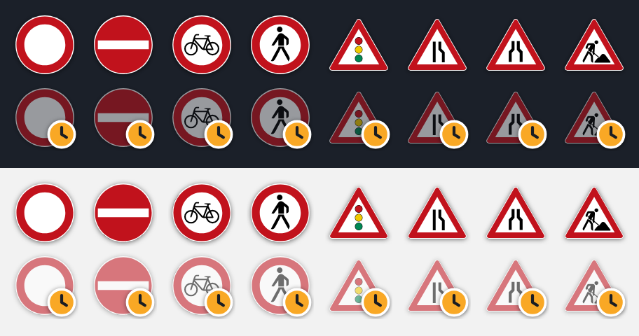

# Construction Site Radar Dortmund

**Know about roadworks before they get in your way.**

Construction Site Radar shows every current and planned construction site in Dortmund on a map, tells you which ones are on the trips you make, how much each one will bother you, and the best way around it. A second website helps the city's planners spread the works out so the city never feels shut all at once.

## Why it exists

Dortmund publishes a list of its construction sites as open data, but a list of addresses and dates does not answer the questions people really have:

- *Will roadworks slow me down on my way to work tomorrow?*
- *Is that closure a big deal, or just scaffolding on a side street?*
- *Which way should I go instead?*
- *For the city: are we closing too many roads in the same neighbourhood at the same time?*

This project turns the city's list into answers to those questions.

## Who it is for

| Who | What they use | What it does for them |
|---|---|---|
| People who live in or travel through Dortmund, on foot, by bike or by car | the **mobile app** (Android) | shows the works on their own routes, rates them, suggests a way around and reminds them before work starts |
| The city's planners | the **planner dashboard**, a website: <https://domove-dashboard-sigma.vercel.app> | shows where works pile up, what to move or do together, which works to finish first and which districts need extra public transport |

## What the mobile app does

- **A live map of construction.** Every site in the city, current and planned. Each one shows the German traffic sign for what it closes (for example "road closed" or "lane narrows"); planned sites are faded and carry a small clock ([what each sign means](docs/map-signs.md)). Choose a Google or Mapbox map, in day or night colours.
- **Details for each site.** Tap a site to see what is closed, who is doing the work and until when.
- **An impact score from 0 to 10.** Not every site matters equally: a closed main road near a school at 8 in the morning is far worse than scaffolding on a quiet street on a Sunday. The score depends on how you travel (walking, cycling or driving) and when, and the app shows every point behind it. A "How scores work" page explains it in plain words.
- **Your saved routes.** Save the trips you make, such as home to work, with the way you travel and when you leave (once, or on chosen weekdays). The app shows only the construction on that route and how much of it has a high impact.
- **A way around.** The app plans the best way around the construction on your route, says how long it takes and what it avoids, and offers up to two other options. One tap opens the chosen way in Google Maps for turn-by-turn directions, or you can follow it in the app.
- **Reminders.** Ask for an alert one week or one day before work starts on your route. Tapping the alert opens that site on the map.
- **Weather.** Dortmund's weather now, with the next 12 hours and 5 days, to help plan the trip.
- **A quiz about the city**, for a minute's distraction while you wait.
- **A guided demo.** The play button walks through all of the above, step by step.

## What the planner dashboard does

The dashboard answers the city's question rather than one person's: across Dortmund and the coming year, are works stacking up so that a neighbourhood loses every way around? It opens on a **To do** list of suggestions, each in a single line, and has a view for each question:

- **Coordinate:** which works clash (close together on the same days), which works on the same stretch of road should be done together, and the best start dates for a new project.
- **Priorities:** which running works to finish first, judged by how disruptive they are, how long they have left, and whether they block emergency services or rail.
- **Transit:** which districts lose roads without a tram or light-rail (Stadtbahn) stop in walking distance, so they need public-transport help.
- **Routes:** how commuters, delivery traffic, emergency services, cyclists and pedestrians get around on a chosen day, and how far a fire station can reach with the day's closures.

Every view follows one chosen day, and numbers are given in things you can count ("clashes with 6 sites on 60 days"). More: [docs/planner-dashboard.md](docs/planner-dashboard.md).

## How it works, in plain words

1. **The city publishes its construction sites** as open data. Every hour our database fetches the latest list, with where each site is and when it runs.
2. **You save a route** in the app. Within a few minutes the system works out the path and finds every site close to it on the days you travel.
3. **Each site gets a score** for your way of travelling and your time of day, using the city's open data on schools, kindergartens, bus stops, hospitals and fire stations nearby.
4. **The app looks for a better way** around the sites that matter and shows it on the map.
5. **Your phone reminds you** before the work starts, at the time you chose.

Everything runs on free services, and there is no server of our own to keep running.

## Where the data comes from

| Data | Source |
|---|---|
| Construction sites, schools, bus stops and other places | [Dortmund open data portal](https://open-data.dortmund.de) |
| Paths and ways around | the public [FOSSGIS router](https://routing.openstreetmap.de), built on OpenStreetMap |
| Weather | [Open-Meteo](https://open-meteo.com) |
| Maps | Google Maps and Mapbox in the app; OpenFreeMap on the dashboard |
| School holidays | [OpenHolidays API](https://openholidaysapi.org) |

## The project's parts

| Folder | What it is |
|---|---|
| `mobile/` | the Android app, built with React Native and Expo |
| `dashboard/` | the planners' website |
| `backend/` | the database (Supabase, a hosted Postgres) that collects the sites, finds them on routes and scores them, plus a small web API |
| `docs/` | how each part is designed, in more detail |

The rest of this page is for developers who want to run or change the project.

---

# For developers

## Mobile app (`mobile/`)

The app renders the same data with Google Maps or Mapbox (toggle in the top-right corner), with a day or night map (sun/moon switch below it; the choice is remembered). Each site shows the German traffic sign for what it closes, faded with a clock while it is only planned ([docs/map-signs.md](docs/map-signs.md)). Below that, a compass points to north on the map while it is turned; tap it to turn the map back to north-up. Under the compass, Dortmund's weather now: a gently moving symbol (sun or moon, clouds, rain, snow, fog or lightning) and the temperature. Tap it for the forecast: what the weather does next, in words, then the next 12 hours and 5 days. It comes from [Open-Meteo](https://open-meteo.com), which is free and needs no key. Mapbox needs native code, so the app runs in a **development build**, not Expo Go.

1. Copy `mobile/.env.example` to `mobile/.env` (gitignored) and fill in:
   - `EXPO_PUBLIC_SUPABASE_URL` / `EXPO_PUBLIC_SUPABASE_PUBLISHABLE_KEY`: see Backend below.
   - `EXPO_PUBLIC_MAPBOX_TOKEN`: Mapbox default public token (free up to 25k monthly users).
   - `EXPO_PUBLIC_GOOGLE_MAPS_API_KEY`: Google Cloud key with **Maps SDK for Android** enabled (mobile map loads are free; Google requires a billing account on file).
2. Build and install the dev app on an Android phone, either:
   - in the cloud: `npx eas-cli@latest build --profile development --platform android` (free Expo account; first run creates `eas.json`; add `EXPO_PUBLIC_GOOGLE_MAPS_API_KEY` with `npx eas-cli env:create` since `.env` is not uploaded), or
   - locally with Android Studio installed: `npx expo run:android`.

   For a sideloadable release APK, every push to `main` runs the **Android APK** workflow (`.github/workflows/android-apk.yml`), and it can also be started by hand from the Actions tab; download the APK from the run's artifacts. It needs the three `EXPO_PUBLIC_MAPBOX_TOKEN` / `EXPO_PUBLIC_SUPABASE_*` values as repository secrets (`gh secret set <NAME>`). If a release APK crashes at launch, see [docs/android-launch-crash.md](docs/android-launch-crash.md).
3. `cd mobile && npx expo start --go` for Expo Go (`--go` matters: this project uses `expo-dev-client`, so a plain `npx expo start` serves a development-build manifest that Expo Go fails to load with "failed to download remote update" / "Something went wrong"). Use a plain `npx expo start` only with the dev build from step 2. If the phone can't reach the server on your Wi-Fi, add `--tunnel`.

Rebuild (step 2) only when native config or native packages change; JS changes reload live.

Checks: `npm test`, `npx tsc --noEmit`, `npx expo lint`.

Route creation and deletion (Issue #1): see [setup, shared route model, API and tests](docs/routes.md).

Each site's card shows an impact score from 0 to 10 for the way you travel, with every point behind it and a "How scores work" sheet; a route's card counts its sites with high impact. How the score is worked out, the database functions and their setup (one migration, then `select private.sync_places();`): [docs/site-rating-and-detours.md](docs/site-rating-and-detours.md).

## Planner dashboard (`dashboard/`)

Live: <https://domove-dashboard-sigma.vercel.app>. A website for the city's planners, on the same data: spread construction works out so the city never feels shut all at once, see which districts need public-transport attention, which running sites to finish first, and how commuters, logistics, emergency services, cyclists and pedestrians get around on a given day. What each view answers and how it scores: [docs/planner-dashboard.md](docs/planner-dashboard.md).

1. Copy `dashboard/.env.example` to `dashboard/.env` (gitignored) and set `VITE_SUPABASE_URL` / `VITE_SUPABASE_PUBLISHABLE_KEY`: the same public values as the app's `EXPO_PUBLIC_SUPABASE_*`.
2. `cd dashboard && npm ci && npm run dev`, then open the printed URL.

Everything else it reads (city open data, school holidays, the FOSSGIS router and OpenFreeMap tiles) is free and needs no key.

Checks: `npm test -- --run`, `npx tsc --noEmit`, `npm run lint`, `npm run build`. `LIVE=1 npx vitest run src/live.test.ts` runs the whole analysis against today's real data.

Deploy: a Vercel project (free Hobby plan) with **Root Directory** `dashboard` and the two `VITE_SUPABASE_*` variables; Vercel detects Vite. From the folder, `npx vercel@latest deploy --prod` uploads the local code.

## Backend (`backend/supabase/`)

Supabase (free plan) with PostGIS. The app reads `construction_sites` through Supabase's REST API with the publishable key; Row Level Security allows reads only. A `pg_cron` job inside Postgres re-syncs both city area feeds every hour (`private.sync_construction_sites()`), storing each site's centre and polygon. A second job fills `obstacles` every 5 minutes (`private.detect_obstacles()`): it asks the public [FOSSGIS router](https://routing.openstreetmap.de) for the path of each new or changed route and stores the sites near it. So there is no server to deploy.

Apply a new migration by pasting the file from `backend/supabase/migrations/` into the Supabase SQL editor and running it.

### API on Vercel (`backend/`)

A small Vercel Function, `GET /api/sites?status=current|planned`, serves the table with a 5-minute edge cache. Vercel Hobby (free) is enough; the hourly sync stays in `pg_cron` because Hobby cron jobs only run daily.

Deploy: import the repo in Vercel, set **Root Directory** to `backend`, and add `SUPABASE_URL` and `SUPABASE_PUBLISHABLE_KEY` (see `backend/.env.example`). Check with `cd backend && npm run typecheck`.

## SQL Tables

The tables for different data in the app.

### Routes

The routes the user is planning to take with planned departure schedule, start, finish and any waypoints.

### Obstacles

The construction sites on the way of each route: every site whose area comes within 30 m of the route's path, or within 55 m of its centre when it has no area, and whose active dates overlap the route's schedule. Repeating routes need an upcoming selected weekday within the site's inclusive date range; single trips use their departure date; routes without a schedule use today. Missing site dates are open-ended. A `pg_cron` job recalculates them every 5 minutes and removes matches that no longer overlap; the app can only read them. Apply `backend/supabase/migrations/20261017140000_obstacles_weekday_alignment.sql` to enable schedule filtering in an existing database.

### Construction Sites

All the construction sites in the city with their locations and planned duration.

## User Stories

### Create a Route

As a user, I want to create routes that I plan to take in the future.

1. The user opens the app.
2. The user taps **Create Route**.
3. The user enters the start destination.
4. The user enters the final destination.
5. The user selects a travel mode: pedestrian, bike, or car.
6. The user enters any intermediate destinations.
7. The user taps **Ready**.
8. The user sees the route in the list of routes.

### View a Route on a Map

As a user, I want to see a map so that I can view my routes.

1. The user opens the app.
2. The user sees a list of routes.
3. The user taps a route.
4. The user sees a map of the route.

### View Construction Sites

As a user, I want to see construction sites so that I can see disruptions.

1. The user opens the app.
2. The user sees a list of routes.
3. The user taps a route.
4. The user sees a map of the route with all current construction sites along it.
5. The user turns on a toggle to see future construction sites.
6. The user sees a map of the route with all current and future construction sites along it.
7. The user taps a construction-site pin and sees its planned duration, client, and type of construction work.

### Receive Push Notifications

As a user, I want to receive push notifications for my usual routes so that I can be prepared.

1. The user receives a push notification: “There is a construction site at __ on your route to __. Take a detour of __ minutes. Tap here to see it.”
2. The user taps the notification.
3. The user sees the detour in Google Maps.
