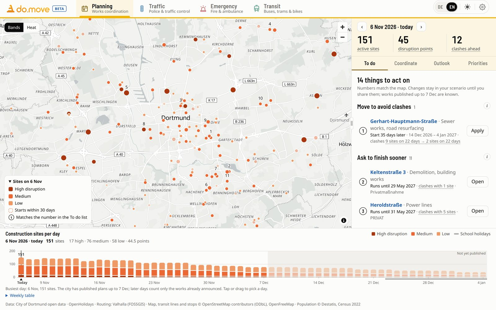
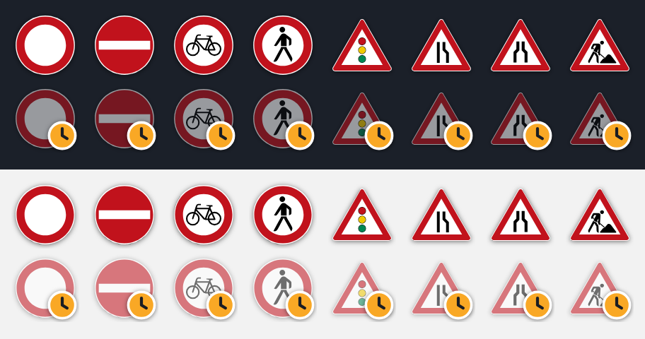
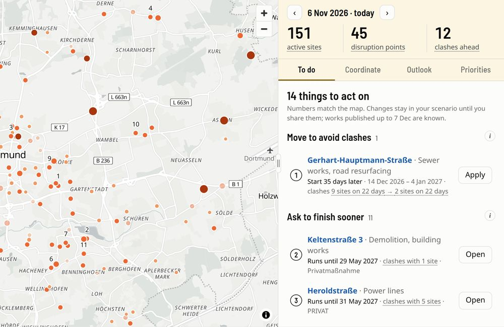
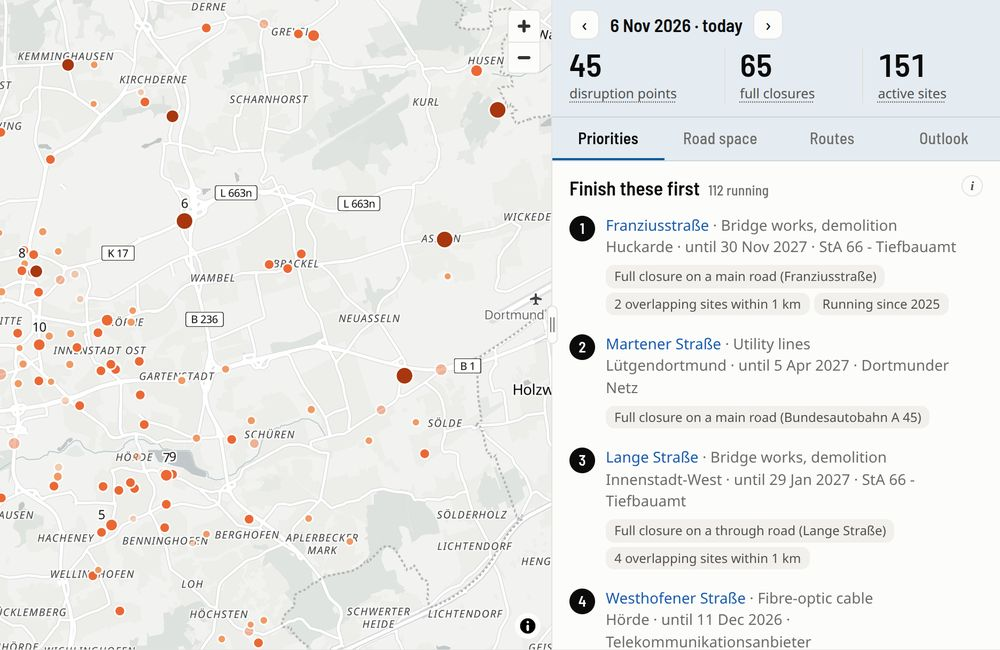
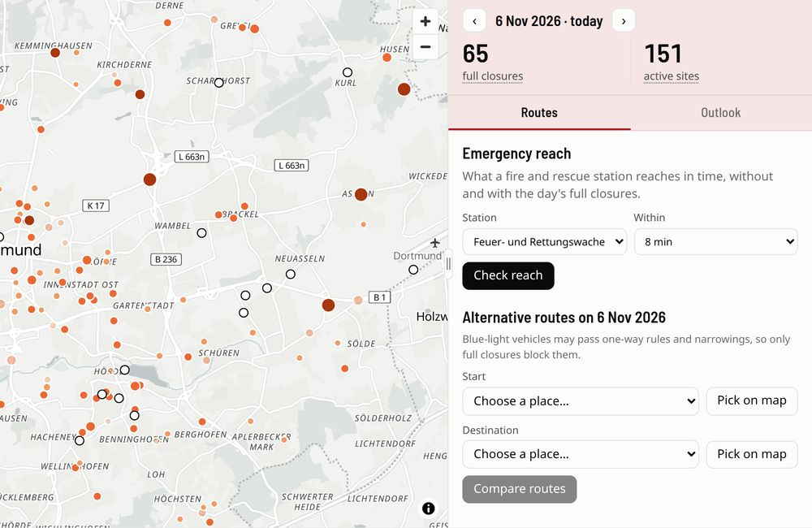
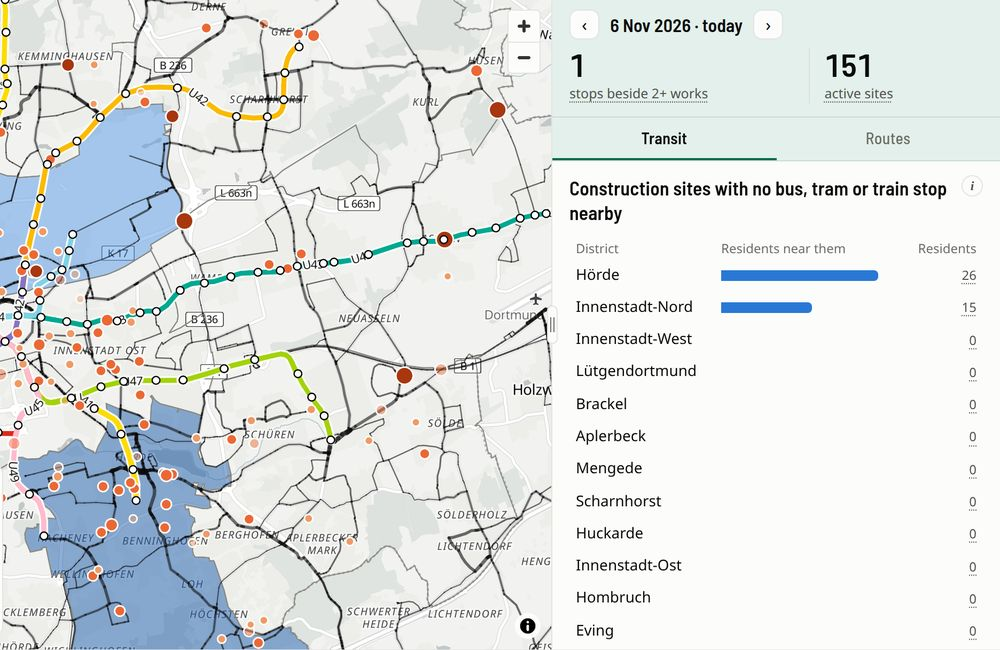
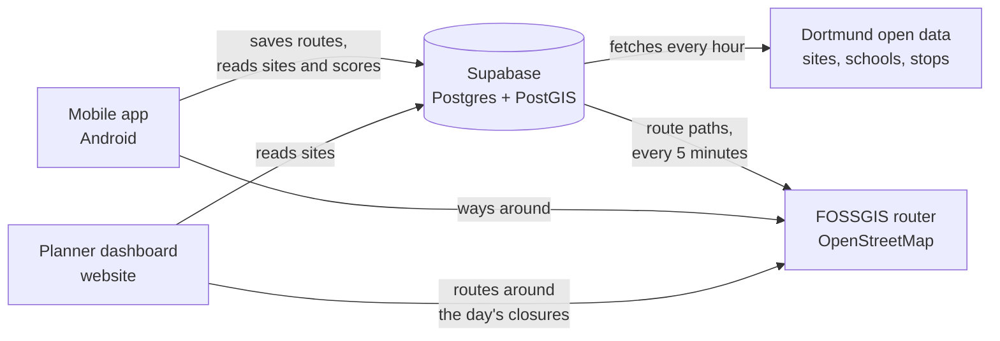

<div align="center">

<a href="https://domove-dashboard-beta.vercel.app"></a>

<h3>Know about roadworks before they get in your way.</h3>

<p>Every current and planned construction site in Dortmund on one map: which ones are on the trips you make,<br>
how much each one will bother you, and the best way around it. A second website helps the city's planners<br>
spread the works out so the city never feels shut all at once.</p>

[](https://github.com/xitij27/domove/actions/workflows/checks.yml) [](https://github.com/xitij27/domove/actions/workflows/android-apk.yml) [](https://github.com/xitij27/domove/releases/latest) [](https://domove-dashboard-beta.vercel.app) [](https://open-data.dortmund.de) [](https://github.com/xitij27/domove/commits/main)

<p>
  <a href="https://domove-dashboard-beta.vercel.app"><strong>Open the dashboard</strong></a>
  &nbsp;&nbsp;|&nbsp;&nbsp;
  <a href="https://github.com/xitij27/domove/releases/latest"><strong>Download the Android app</strong></a>
  &nbsp;&nbsp;|&nbsp;&nbsp;
  <a href="#how-it-works">How it works</a>
  &nbsp;&nbsp;|&nbsp;&nbsp;
  <a href="#for-developers">For developers</a>
  &nbsp;&nbsp;|&nbsp;&nbsp;
  <a href="Do.Move%20presentation.pdf">Slides (PDF)</a>
</p>

<a href="https://domove-dashboard-beta.vercel.app">
  <picture>
    <source media="(prefers-color-scheme: dark)" srcset="docs/images/readme/dashboard-dark.jpg">
    
  </picture>
</a>

<sub>The planner dashboard on 6 November 2026: 151 sites coloured by how much each disrupts, what to act on, and the weeks ahead. <a href="https://domove-dashboard-beta.vercel.app">Open it</a>.</sub>

</div>

<br>

## Why it exists

Dortmund publishes a list of its construction sites as open data, but a list
of addresses and dates does not answer the questions people really have:

- *Will roadworks slow me down on my way to work tomorrow?*
- *Is that closure a big deal, or just scaffolding on a side street?*
- *Which way should I go instead?*
- *For the city: are we closing too many roads in the same neighbourhood at the same time?*

This project turns the city's list into answers to those questions.

## Who it is for

<table>
  <tr>
    <td width="50%" valign="top">
      <h3><a href="#what-the-mobile-app-does">The mobile app</a></h3>
      For people who live in or travel through Dortmund, on foot, by bike or by car.
      <br><br>
      It shows the works on their own routes, rates them, suggests a way around and reminds them before work starts.
      <br><br><sub>Android · <a href="https://github.com/xitij27/domove/releases/latest">download the latest release</a></sub>
    </td>
    <td width="50%" valign="top">
      <h3><a href="#what-the-planner-dashboard-does">The planner dashboard</a></h3>
      For the city: road works planners, traffic police and control, fire and ambulance, and the bus and tram operator, with one role for each.
      <br><br>
      Planners see where works pile up and what to move or do together · traffic, where the works hurt most and the detours · fire and ambulance, what the day's closures do to each station's reach · transit, which districts and stops the works cut off.
      <br><br><sub>A website · <a href="https://domove-dashboard-beta.vercel.app">domove-dashboard-beta.vercel.app</a></sub>
    </td>
  </tr>
</table>

## What the mobile app does

<p align="center">
  
  <br>
  <sub>Each site on the map wears the German traffic sign for what it closes. Planned sites are faded and carry a small clock. Night map above, day map below.</sub>
</p>

- **A live map of construction.** Every site in the city, current and planned. Each one shows the German traffic sign for what it closes (for example "road closed" or "lane narrows"); planned sites are faded and carry a small clock ([what each sign means](docs/map-signs.md)). Choose a Google or Mapbox map, in day or night colours. The map moves to where you are once location is allowed, and a button brings it back to you.
- **Details for each site.** Tap a site to see what is closed, who is doing the work and until when.
- **An impact score from 0 to 10.** Not every site matters equally: a closed main road near a school at 8 in the morning is far worse than scaffolding on a quiet street on a Sunday. The score depends on how you travel (walking, cycling or driving) and when, and the app shows every point behind it. A "How scores work" page explains it in plain words.
- **Your saved routes.** Save the trips you make, such as home to work, with the way you travel and when you leave (once, or on chosen weekdays). The app shows only the construction on that route and how much of it has a high impact.
- **A way around.** The app plans the best way around the construction on your route, says how long it takes and what it avoids, and offers up to two other options. One tap opens the chosen way in Google Maps for turn-by-turn directions; the app does no navigation itself.
- **Reminders.** Ask for an alert one week or one day before work starts on your route. Tapping the alert opens that site on the map.
- **Weather.** Dortmund's weather now, with the next 12 hours and 5 days, to help plan the trip.
- **A quiz about the city**, for a minute's distraction while you wait.
- **A guided demo.** The play button walks through all of the above, step by step.
- **English or German.** The app starts in the phone's language; **Settings** (the gear under the map controls) changes it, and the app remembers the choice.
- **Updates from inside the app.** On Android, **Settings → Check for updates** compares the app with the latest GitHub release and, if it is newer, downloads and installs it after one tap on Android's confirmation. More: [docs/app-updates.md](docs/app-updates.md).

## What the planner dashboard does

The dashboard answers the city's question rather than one person's: across
Dortmund and the coming year, are works stacking up so that a neighbourhood
loses every way around? Its features are grouped into four **roles**, picked
at the top of the page. Each role shows only its own views, its own key
figures and its own places on the map:

<table>
  <tr>
    <td width="50%" valign="top">
      
      <h3>Planning</h3>
      <sub>Works coordination</sub>
      <br><br>
      Opens on a <strong>To do</strong> list of suggestions, each in a single line. Then <strong>Coordinate</strong> (which works clash, which works on the same stretch should be done together, and the best start dates for a new project), <strong>Outlook</strong> (what starts, runs and ends in the next 7, 14 or 30 days) and <strong>Priorities</strong> (which running works to finish first). Only this role can move works and try out proposed projects.
    </td>
    <td width="50%" valign="top">
      
      <h3>Traffic</h3>
      <sub>Police and traffic control</sub>
      <br><br>
      <strong>Priorities</strong>, <strong>Road space</strong> (each district's road space per resident; the day's works change it only a little), <strong>Routes</strong> for commuters and lorries around the day's closures, and <strong>Outlook</strong>.
    </td>
  </tr>
  <tr>
    <td width="50%" valign="top">
      
      <h3>Emergency</h3>
      <sub>Fire and ambulance</sub>
      <br><br>
      <strong>Routes</strong>: how far a chosen fire and rescue station reaches in 5–12 minutes with and without the day's full closures, and routes for blue-light vehicles. Also <strong>Outlook</strong>, and the fire stations and hospitals on the map.
    </td>
    <td width="50%" valign="top">
      
      <h3>Transit</h3>
      <sub>Buses, trams and bikes</sub>
      <br><br>
      <strong>Transit</strong> (how many people live near works that have no bus, tram or train stop in walking distance, from the 2022 census, and which Stadtbahn stops sit beside two or more works) and <strong>Routes</strong> for cyclists and pedestrians. Its map draws the Stadtbahn lines in their own colours, the S-Bahn and regional trains, and the bus lines (wider where more lines share a street), with stops, bike-share stations and P+R sites. Each can be switched on or off, and a chip per Stadtbahn line picks out its route.
    </td>
  </tr>
</table>

Every view follows one chosen day, and a timeline under the map counts the
sites running each day, by how much they disrupt. Numbers are given in things
you can count ("clashes with 6 sites on 60 days"). It opens in German and
light, whatever the browser's settings. The **DE | EN** switch and the
sun/moon button, in the toolbar at the top right beside the settings gear,
change them, and the browser remembers both, as it does the role. More:
[docs/planner-dashboard.md](docs/planner-dashboard.md).

## How it works

1. **The city publishes its construction sites** as open data. Every hour our database fetches the latest list, with where each site is and when it runs.
2. **You save a route** in the app. Within a few minutes the system works out the path and finds every site close to it on the days you travel.
3. **Each site gets a score** for your way of travelling and your time of day, using the city's open data on schools, kindergartens, bus stops, hospitals and fire stations nearby.
4. **The app looks for a better way** around the sites that matter and shows it on the map.
5. **Your phone reminds you** before the work starts, at the time you chose.



> [!NOTE]
> Everything runs on free services, and there is no server of our own to keep running.

## Where the data comes from

| Data | Source |
|---|---|
| Construction sites, schools, bus stops and other places | [Dortmund open data portal](https://open-data.dortmund.de), under Datenlizenz Deutschland – Zero 2.0 |
| Paths and ways around | the public [FOSSGIS router](https://routing.openstreetmap.de), built on OpenStreetMap |
| Weather | [Open-Meteo](https://open-meteo.com) |
| Maps | Google Maps and Mapbox in the app; OpenFreeMap on the dashboard |
| Transit lines and stops on the dashboard | OpenStreetMap contributors, under the ODbL |
| Residents per district on the dashboard | © Statistisches Bundesamt (Destatis), Zensus 2022 |
| School holidays | [OpenHolidays API](https://openholidaysapi.org) |

## The project's parts

| Folder | What it is |
|---|---|
| [`mobile/`](mobile/) | the Android app, built with React Native and Expo |
| [`dashboard/`](dashboard/) | the planners' website |
| [`backend/`](backend/) | the database (Supabase, a hosted Postgres) that collects the sites, finds them on routes and scores them, plus a small web API |
| [`docs/`](docs/) | how each part is designed, in more detail |
| [`.github/`](.github/) | the automatic checks and the Android APK build (see below) |

<details>
<summary><strong>The full layout</strong></summary>

<br>

```
domove/
├── mobile/                      Android app (React Native, Expo)
│   ├── App.tsx, index.ts        entry points
│   ├── app.config.ts            Expo and native config
│   ├── plugins/                 config plugins (crash log, Gradle memory)
│   ├── scripts/render-signs.py  draws the map's traffic signs
│   └── src/
│       ├── demo/                the guided demo
│       ├── detours/             ways around a route (planner, API, summary card)
│       ├── i18n/                English and German texts
│       ├── maps/                Google and Mapbox maps, compass, signs
│       ├── notifications/       reminders before work starts
│       ├── quiz/                the city quiz (English and German)
│       ├── ratings/             impact score and "How scores work"
│       ├── routes/              saved routes: form, place picker, API
│       ├── settings/            language, updates
│       ├── updates/             in-app update from GitHub releases
│       ├── weather/             weather now and forecast
│       └── sites.ts, theme.ts, motion.tsx
├── dashboard/                   planner website (Vite, React)
│   ├── public/                  population and transit data files, logo
│   ├── scripts/                 build the population and transit data files
│   ├── ANALYTICS.md             how the dashboard's numbers are worked out
│   └── src/
│       ├── data/                loads city, holiday and Supabase data
│       ├── i18n/                English and German texts
│       ├── model/               the analysis: clashes, impact, closures,
│       │                        capacity, outlook, what-if projects, settings
│       ├── routing/             routes around the day's closures
│       └── ui/                  role views (To do, Coordinate, Priorities,
│                                Road space, Routes, Transit, Outlook), map,
│                                Settings with the severity table
├── backend/
│   ├── api/sites.ts             Vercel Function: GET /api/sites
│   └── supabase/
│       ├── migrations/          database schema and functions, in order
│       └── tests/               database tests and a REST check for routes
├── docs/                        design notes (see below)
├── .github/workflows/           checks.yml (tests on every pull request),
│                                android-apk.yml (release APK)
└── Do.Move presentation.pdf     project slides
```

</details>

### Documents in `docs/`

| File | About |
|---|---|
| [planner-dashboard.md](docs/planner-dashboard.md) | what each dashboard role and view answers, and how it scores |
| [site-rating-and-detours.md](docs/site-rating-and-detours.md) | the impact score and the ways around |
| [routes.md](docs/routes.md) | saved routes: model, API, setup, tests |
| [map-signs.md](docs/map-signs.md) | what each traffic sign on the map means |
| [notifications.md](docs/notifications.md) | reminders |
| [app-updates.md](docs/app-updates.md) | updating the app from inside |
| [android-launch-crash.md](docs/android-launch-crash.md) | fixing a release APK that crashes at launch |
| [darmstadt.md](docs/darmstadt.md) | research for adding a second city |
| [dortmund-data-check.md](docs/dortmund-data-check.md) | a check of the city's open data |
| [route-planning-open-questions.md](docs/route-planning-open-questions.md), [routes-database-todo.md](docs/routes-database-todo.md), [traffic-and-open-data-ideas.md](docs/traffic-and-open-data-ideas.md) | open questions, to-dos and ideas |

<br>

## For developers

The rest of this page is for developers who want to run or change the project.

| Part | Start it | Checks |
|---|---|---|
| [Mobile app](#mobile-app) | `cd mobile && npx expo start --go` | `npm test` · `npx tsc --noEmit` · `npx expo lint` |
| [Planner dashboard](#planner-dashboard) | `cd dashboard && npm ci && npm run dev` | `npm test -- --run` · `npx tsc --noEmit` · `npm run lint` · `npm run build` |
| [Backend](#backend) | paste a migration into the Supabase SQL editor | `cd backend && npm run typecheck` · `supabase test db` |

Each part reads its keys from a `.env` file (gitignored) that you copy from
its `.env.example` first.

### Mobile app

In `mobile/`. The app renders the same data with Google Maps or Mapbox. On
the map screen, from the top right:

- **The map toggle** switches between Google Maps and Mapbox.
- **The sun/moon switch** below it picks a day or night map; the choice is remembered.
- **The compass** points to north on the map while it is turned; tap it to turn the map back to north-up.
- **The weather**, under the compass: Dortmund's weather now, as a gently moving symbol (sun or moon, clouds, rain, snow, fog or lightning) and the temperature. Tap it for the forecast: what the weather does next, in words, then the next 12 hours and 5 days. It comes from [Open-Meteo](https://open-meteo.com), which is free and needs no key.

Each site shows the German traffic sign for what it closes, faded with a
clock while it is only planned ([docs/map-signs.md](docs/map-signs.md)).

> [!NOTE]
> Mapbox needs native code, so the app runs in a **development build**, not Expo Go.

1. Copy `mobile/.env.example` to `mobile/.env` (gitignored) and fill in:
   - `EXPO_PUBLIC_SUPABASE_URL` / `EXPO_PUBLIC_SUPABASE_PUBLISHABLE_KEY`: see [Backend](#backend) below.
   - `EXPO_PUBLIC_MAPBOX_TOKEN`: Mapbox default public token (free up to 25k monthly users).
   - `EXPO_PUBLIC_GOOGLE_MAPS_API_KEY`: Google Cloud key with **Maps SDK for Android** enabled (mobile map loads are free; Google requires a billing account on file).
2. Build and install the dev app on an Android phone, either:
   - in the cloud: `npx eas-cli@latest build --profile development --platform android` (free Expo account; first run creates `eas.json`; add `EXPO_PUBLIC_GOOGLE_MAPS_API_KEY` with `npx eas-cli env:create` since `.env` is not uploaded), or
   - locally with Android Studio installed: `npx expo run:android`.
3. `cd mobile && npx expo start --go` for Expo Go. Use a plain `npx expo start` only with the dev build from step 2. If the phone can't reach the server on your Wi-Fi, add `--tunnel`.

> [!IMPORTANT]
> `--go` matters: this project uses `expo-dev-client`, so a plain `npx expo start` serves a development-build manifest that Expo Go fails to load with "failed to download remote update" / "Something went wrong".

> [!TIP]
> Rebuild (step 2) only when native config or native packages change; JS changes reload live.

**Release APK.** Every push to `main` that changes `mobile/` (or the workflow
itself) runs the **Android APK** workflow
([`.github/workflows/android-apk.yml`](.github/workflows/android-apk.yml)),
uploads the APK as a run artifact and publishes it as the next
[GitHub release](https://github.com/xitij27/domove/releases), whose tag
becomes the app's version. The release APK is 64-bit Android only and signed
with the standard debug key, for sideloading only. The workflow can also be
started by hand from the Actions tab; such a run is not released, so download
its APK from the run's artifacts. It needs the three
`EXPO_PUBLIC_MAPBOX_TOKEN` / `EXPO_PUBLIC_SUPABASE_*` values as repository
secrets (`gh secret set <NAME>`). If a release APK crashes at launch, see
[docs/android-launch-crash.md](docs/android-launch-crash.md).

Checks: `npm test`, `npx tsc --noEmit`, `npx expo lint`.

Route creation and deletion (Issue #1): see [setup, shared route model, API and tests](docs/routes.md).

Each site's card shows an impact score from 0 to 10 for the way you travel,
with every point behind it and a "How scores work" sheet; a route's card
counts its sites with high impact. How the score is worked out, the database
functions and their setup (one migration, then `select private.sync_places();`):
[docs/site-rating-and-detours.md](docs/site-rating-and-detours.md).

### Planner dashboard

In `dashboard/`. Live: <https://domove-dashboard-beta.vercel.app>. A website
for the city on the same data, with a role each for planning, traffic,
emergency services and transit: spread construction works out so the city
never feels shut all at once, see which districts need public-transport
attention, which running sites to finish first, what the day's closures do to
fire stations' reach, and how commuters, logistics, emergency services,
cyclists and pedestrians get around on a given day. What each role and view
answers and how it scores: [docs/planner-dashboard.md](docs/planner-dashboard.md).

1. Copy `dashboard/.env.example` to `dashboard/.env` (gitignored) and set `VITE_SUPABASE_URL` / `VITE_SUPABASE_PUBLISHABLE_KEY`: the same public values as the app's `EXPO_PUBLIC_SUPABASE_*`.
2. `cd dashboard && npm ci && npm run dev`, then open the printed URL.

Everything else it reads (city open data, school holidays, the FOSSGIS router
and OpenFreeMap tiles) is free and needs no key.

Checks: `npm test -- --run`, `npx tsc --noEmit`, `npm run lint`, `npm run build`.
`LIVE=1 npx vitest run src/live.test.ts` runs the whole analysis against
today's real data. `node scripts/population.mjs` and
`node scripts/transit-network.mjs` rebuild `public/population.json` and the
`public/transit-*.json` files.

**Deploy:** a Vercel project (free Hobby plan) with **Root Directory**
`dashboard` and the two `VITE_SUPABASE_*` variables; Vercel detects Vite. From
the folder, `npx vercel@latest deploy --prod` uploads the local code.

### Languages (English and German)

Both apps keep every word they show in `src/i18n/`: `en.ts` is the source, and
`de.ts` is typed as it, so a missing or misshapen German entry fails `tsc`.
There is no i18n library; each `index.ts` is a small store.

- **Starting language:** the one picked last (the app's `language.txt`, the dashboard's `localStorage`), else German when the phone or browser is set to German, else English.
- **In components,** `const t = useStrings()`; the component renders again when the language changes. Code outside components (validation, notifications, the dashboard's model and CSV export) calls `strings()`. Dashboard memos that word things take `t` as an argument, so a switch works them out again.
- **To change a text,** edit it in `en.ts` and `de.ts`. To add one, add the key to both. Sentences with a number or name in them are functions, so each language can put the parts in its own order and plural; on the dashboard, a sentence with a tooltip or bold name in it takes those as nodes and joins them with `rich()`.
- **Dates and numbers** follow the language (en-GB or de-DE, with a decimal comma in German).
- **The quiz** has its German questions in `mobile/src/quiz/questions.de.ts`, by question id; options keep the English order, since a choice's answer is its index.
- **Not translated:** data from the city's feeds (site titles, owners, districts), place names, and developer-only setup errors.
- **Tests** run in English whatever the machine's language; `src/i18n/i18n.test.ts` in each app checks German has every key.

### Backend

In `backend/supabase/`. Supabase (free plan) with PostGIS. The app reads
`construction_sites` through Supabase's REST API with the publishable key; Row
Level Security allows reads only. Jobs run by `pg_cron` inside Postgres do
the work, so there is no server to deploy:

- **Every hour**, `private.sync_construction_sites()` re-syncs both city area feeds, storing each site's centre and polygon.
- **Ten minutes after each sync**, `private.record_site_history()` copies every site into `construction_site_history`, one row per version with the first and last sync that saw it. The city's feed drops works once they end and replaces a site when its dates change, so this table is the only record of past works and of how often dates move.
- **Every 5 minutes**, `private.detect_obstacles()` fills `obstacles`: it asks the public [FOSSGIS router](https://routing.openstreetmap.de) for the path of each new or changed route and stores the sites near it.

Apply a new migration by pasting the file from `backend/supabase/migrations/`
into the Supabase SQL editor and running it.

#### API on Vercel

In `backend/`. A small Vercel Function, `GET /api/sites?status=current|planned`,
serves the table with a 5-minute edge cache. Vercel Hobby (free) is enough;
the hourly sync stays in `pg_cron` because Hobby cron jobs only run daily.

**Deploy:** import the repo in Vercel, set **Root Directory** to `backend`, and
add `SUPABASE_URL` and `SUPABASE_PUBLISHABLE_KEY` (see `backend/.env.example`).
Check with `cd backend && npm run typecheck`. Database tests live in
`backend/supabase/tests/` and run with `supabase test db`.

#### Continuous checks

The **Checks** workflow ([`.github/workflows/checks.yml`](.github/workflows/checks.yml))
runs the app's and dashboard's tests, type check, lint and build, plus the
database tests, on every pull request and push to `main`.

### SQL tables

| Table | What it holds |
|---|---|
| `routes` | the routes the user is planning to take, with planned departure schedule, start, finish and any waypoints |
| `obstacles` | the construction sites on the way of each route (rules below) |
| `construction_sites` | all the construction sites in the city, with their locations and planned duration |
| `construction_site_history` | one row per version of every site, kept after the city's feed drops it (see [Backend](#backend)) |

**Obstacles** are every site whose area comes within 30 m of the route's path,
or within 55 m of its centre when it has no area, and whose active dates
overlap the route's schedule. Repeating routes need an upcoming selected
weekday within the site's inclusive date range; single trips use their
departure date; routes without a schedule use today. Missing site dates are
open-ended. A `pg_cron` job recalculates them every 5 minutes and removes
matches that no longer overlap; the app can only read them. Apply
`backend/supabase/migrations/20261017140000_obstacles_weekday_alignment.sql`
to enable schedule filtering in an existing database.

### User stories

<details>
<summary><strong>Create a route</strong></summary>

<br>

As a user, I want to create routes that I plan to take in the future.

1. The user opens the app.
2. The user taps **Create Route**.
3. The user enters the start destination.
4. The user enters the final destination.
5. The user selects a travel mode: pedestrian, bike, or car.
6. The user enters any intermediate destinations.
7. The user taps **Ready**.
8. The user sees the route in the list of routes.

</details>

<details>
<summary><strong>View a route on a map</strong></summary>

<br>

As a user, I want to see a map so that I can view my routes.

1. The user opens the app.
2. The user sees a list of routes.
3. The user taps a route.
4. The user sees a map of the route.

</details>

<details>
<summary><strong>View construction sites</strong></summary>

<br>

As a user, I want to see construction sites so that I can see disruptions.

1. The user opens the app.
2. The user sees a list of routes.
3. The user taps a route.
4. The user sees a map of the route with all current construction sites along it.
5. The user turns on a toggle to see future construction sites.
6. The user sees a map of the route with all current and future construction sites along it.
7. The user taps a construction-site pin and sees its planned duration, client, and type of construction work.

</details>

<details>
<summary><strong>Receive push notifications</strong></summary>

<br>

As a user, I want to receive push notifications for my usual routes so that I can be prepared.

1. The user receives a push notification: “There is a construction site at __ on your route to __. Take a detour of __ minutes. Tap here to see it.”
2. The user taps the notification.
3. The user sees the detour in Google Maps.

</details>

<br>

<div align="center">
<sub><a href="https://domove-dashboard-beta.vercel.app">Planner dashboard</a> &nbsp;|&nbsp; <a href="https://github.com/xitij27/domove/releases/latest">Android app</a> &nbsp;|&nbsp; <a href="docs/planner-dashboard.md">How the dashboard scores</a> &nbsp;|&nbsp; <a href="Do.Move%20presentation.pdf">Slides</a> &nbsp;|&nbsp; <a href="https://github.com/xitij27/domove/issues">Issues</a></sub>
</div>
