# Traffic signs for construction sites on the map

Decided · 17 Oct 2026

**Decision:** the eight signs in the first table, on both maps. **Decided by:** xitij27, 17 Oct 2026.

Until then every site on the map was a red pin (current) or a yellow pin (planned), so the map showed where something was happening but not what it did to traffic. Now each site shows a German traffic sign (StVO) for its kind of restriction. The site counts come from the app's title matcher (`closureOf` in [mobile/src/sites.ts](../mobile/src/sites.ts)) run on the titles of the 212 sites in the two city feeds on 17 Oct 2026.

## The signs

The signs come in two shapes, and German drivers already read them this way:

- **Red-ringed circles** (prohibition signs, *Vorschriftzeichen*) mean **you can't get through**.
- **Red-bordered triangles** (warning signs, *Gefahrzeichen*) mean **you get through, but slower**.

That matches the "blocked" and "slowed" impacts that #12's route planner works with. It also helps colour-blind users, because the shape carries the meaning, not just red against yellow.

| Sign | StVO sign and its meaning in Germany | We'd show it for | Sites | Example title from the feed |
|:---:|---|---|---:|---|
| 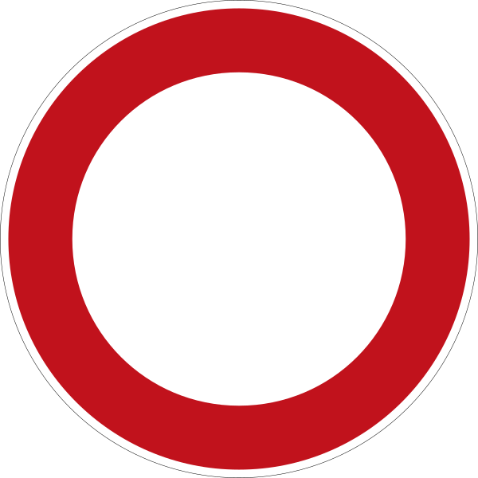 | **250** *Verbot für Fahrzeuge aller Art*: no vehicles, bikes included; people on foot may pass | full closure (*Vollsperrung*, *VSP*) | 92 | Langenacker - Straßenbau // Vollsperrung |
| 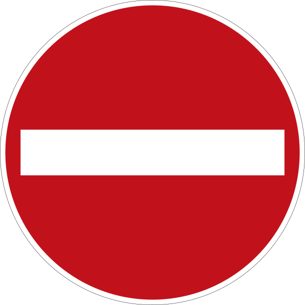 | **267** *Verbot der Einfahrt*: no entry from this end, as at the wrong end of a one-way street | one-way rule (*Einbahnstraße*) | 11 | Poststraße - Neubau // Einbahnstraße |
| 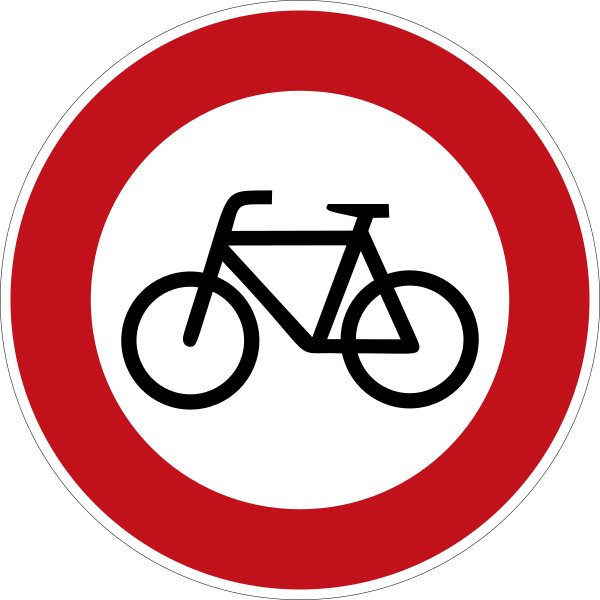 | **254** *Verbot für Radverkehr*: no cycling | cycle path closed | 4 | Emscherradweg zw. "Bergparte" und "Schürener Vorstadt" - Ausbau Radweg /// Vollsperrung |
| 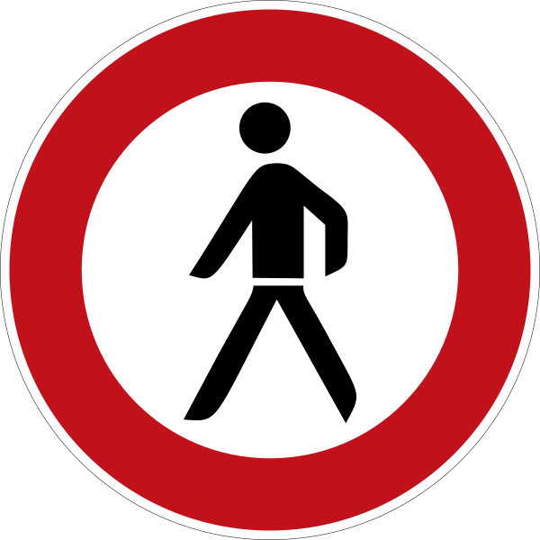 | **259** *Verbot für Fußgänger*: no walking | sidewalk or footpath closed | 5 | Preinstraße 74 - Neubau Wohnhaus // Gehwegsperrung |
| 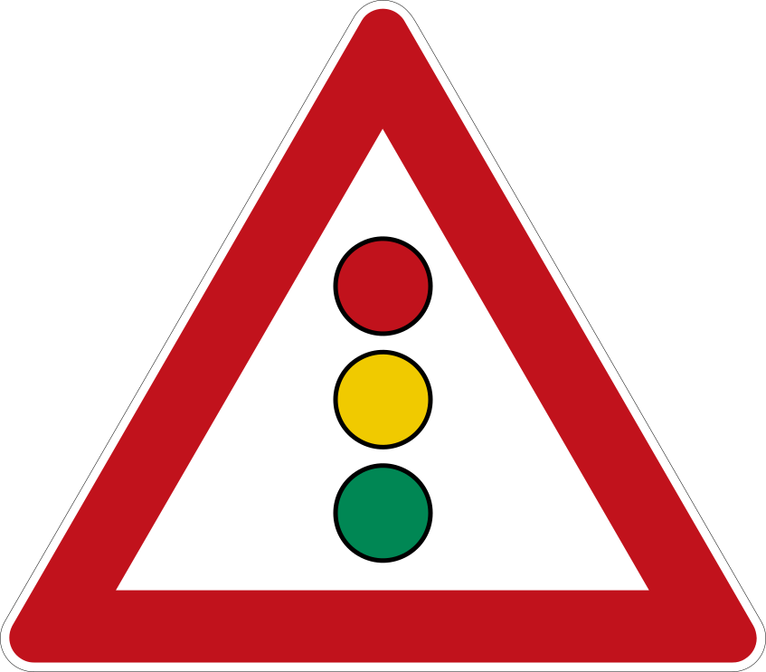 | **131** *Lichtzeichenanlage*: traffic lights ahead | temporary traffic lights (*LSA*, *Ampel*) | 15 | Kurze Hecke - Wasserrohrbruch // halbseitige Sperrung mit Ampel |
| 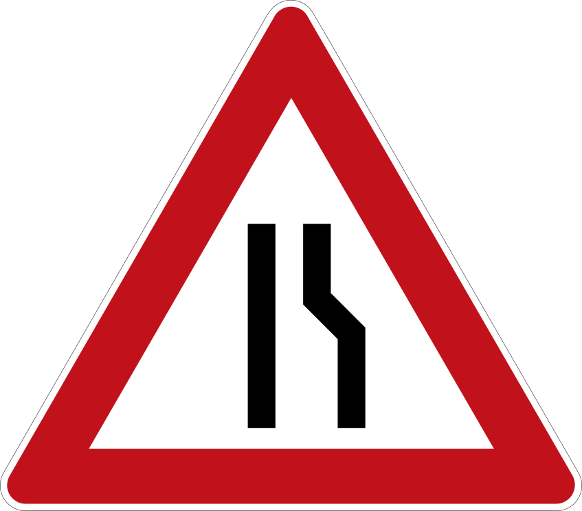 | **121** *Einseitig verengte Fahrbahn*: the road narrows on one side | half closure (*halbseitige Sperrung*, *halbs. Sp.*) | 41 | Feldstraße 81 - Kranstellung für Neubau // Halbseitige Sperrung |
| 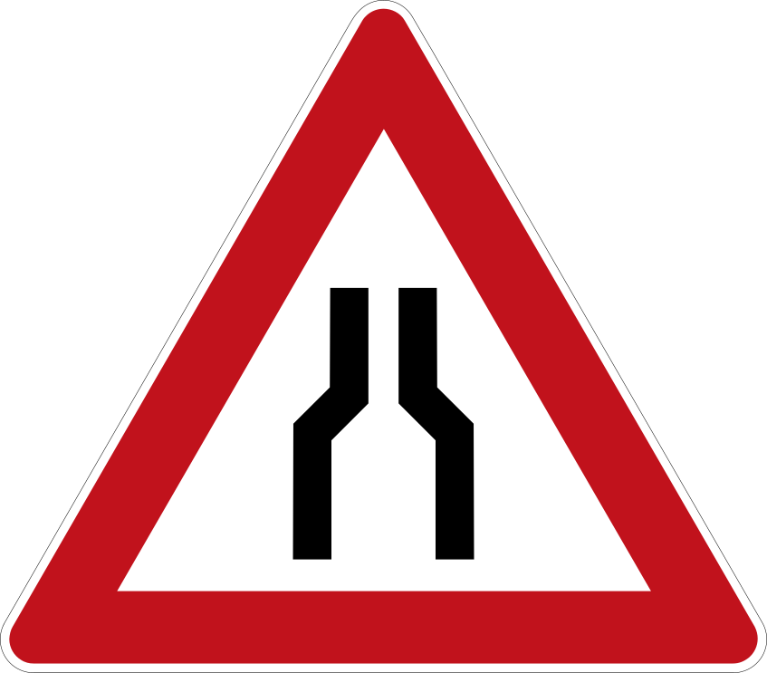 | **120** *Verengte Fahrbahn*: the road narrows | narrowing or lane reduction (*Fahrbahneinengung*, *Spureinzug*) | 24 | Linnigmannstr. 26 - Hausanschluss /// Fahrbahneinengung |
| 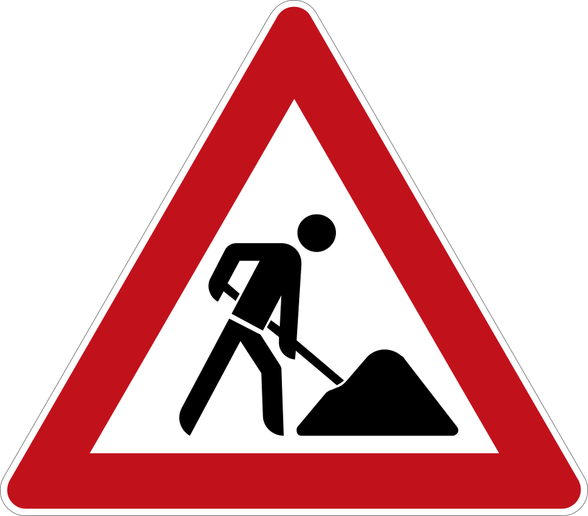 | **123** *Arbeitsstelle*: roadworks | everything else: the title names no restriction, or only closed parking | 20 | Leostraße - Fahrbahnerneuerung |

A site shows one sign. When a title names several restrictions, the most restrictive one for road traffic wins, in this order: full closure, one-way, traffic lights, half closure, narrowing. So "Halbseitige Sperrung + LSA" shows the traffic light, and "Vollsperrung u. Halbs. Sperrung" the full closure. The restriction usually follows "//" and is read first, so "Austausch LSA // Einengung" (traffic lights being replaced, road narrowed) shows the narrowing. The bike and pedestrian signs show where only the cycle path or the sidewalk is closed, as in "Ausbau Radweg /// Vollsperrung" or "Gehwegsperrung", so a closed cycle path doesn't get the sign for cars.

## Why not the stop sign

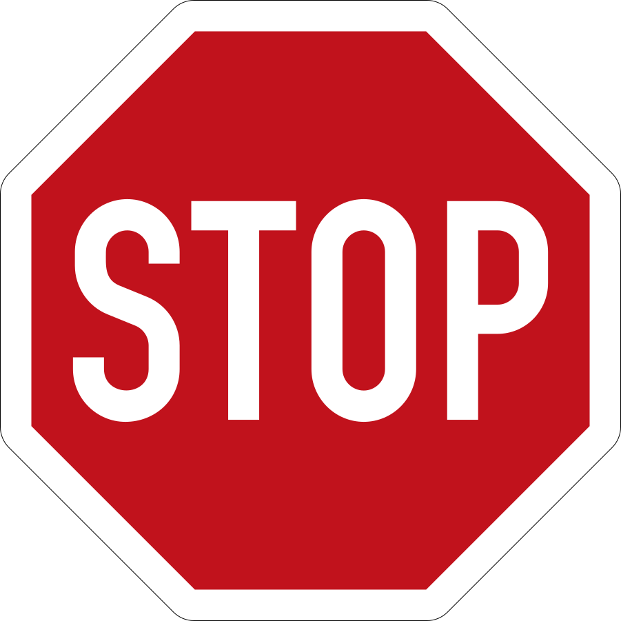

In Germany the stop sign (**206** *Halt! Vorfahrt gewähren!*) means "stop at the line, give way, then drive on". It stands at junctions, never at closures, so on the map it would read as a junction or as "stop here", not as "closed". A closed street in Germany shows **250** together with the red and white barrier (**600**, below).

250 also says exactly what we decided for full closures in [route planning question 4](route-planning-open-questions.md#4-does-a-full-road-closure-block-people-on-foot-and-on-bikes): bikes can't ride through, but people on foot can, and you may push a bike.

## Alternatives we looked at

| Sign | Instead of | For | Against |
|:---:|---|---|---|
|  | 250 for full closures | The solid red disc is the most eye-catching sign, and it looks like the closure icon in Google Maps | In Germany it means "no entry from this end", a one-way rule. One-way streets would then need the blue arrow (220), and only 1 of the 11 one-way titles names the direction |
| 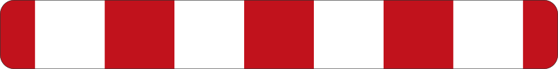 | 250 for full closures | **600** *Absperrschranke* is the barrier people actually see at a closure, and it reads as "closed" at once | Eight times wider than high, so it makes a clumsy marker and covers the street; it would need a shorter, cut-down version |
| 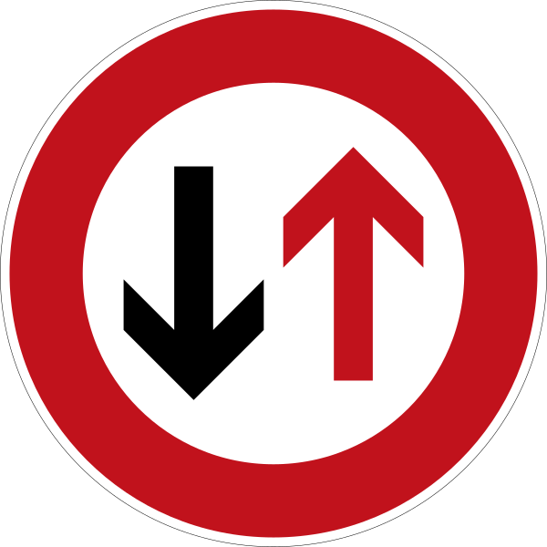 | 121 for half closures | **208** *Vorrang des Gegenverkehrs* (give way to oncoming traffic) stands at many half closures without lights, and at small sizes it's easier to tell apart from 120 than 121 is | It's round, which breaks "circle means you can't get through" |

## Left out

| Sign | Why not |
|:---:|---|
| 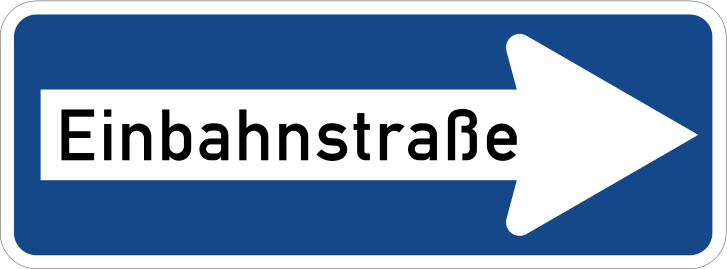 | **220** *Einbahnstraße*: its arrow would point in a direction we don't know for 10 of the 11 one-way sites |
| 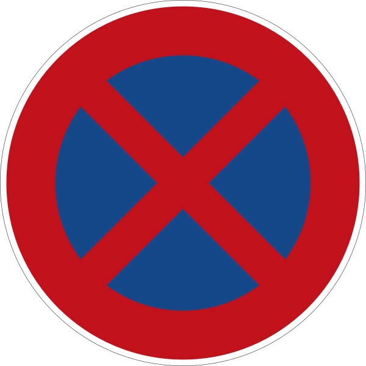 | **283** *Absolutes Haltverbot*: only 2 sites close parking ("Haltverbote für Neubau", "Sperrung Parkstreifen"), and that doesn't slow anyone driving through; they show 123 |
| 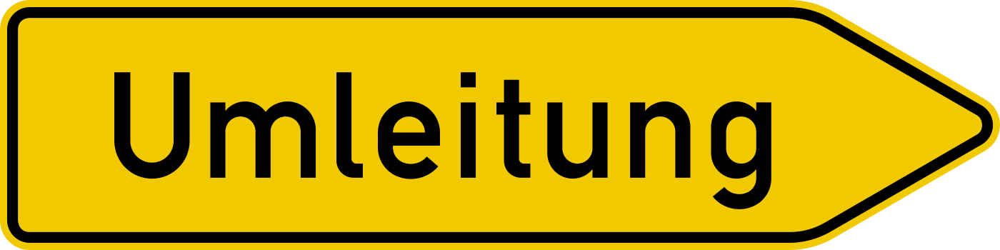 | **454** *Umleitung*: a detour sign marks the way around, not the site. It may suit the detour line that #12 draws later |

## How the map shows them

1. **Current and planned.** Current sites show the sign as it is. Planned sites show it faded, with a yellow clock in the corner. The "Current" and "Planned" chips at the top of the map show the roadworks sign both ways. Not taken: a white plate under the sign (*Zusatzzeichen*) reading "ab 26.10.", which German drivers know but which is too small to read at marker size.
2. **Size and zoom.** At marker size the three triangles 120, 121 and 123 are hard to tell apart, and 212 signs at city zoom are a lot. Here is the row at 24 px:

          

   The Mapbox map shrinks the signs at city zoom to about the size of the old dots (55 % at zoom 10) and shows them at full size, 32 dp, from zoom 14. The Google map can't scale a marker image by zoom, so it shows 32 dp at every zoom, about the size of its old pins. Where signs overlap, the more restrictive one lies on top. 120 and 121 stay separate signs for now; if they look the same on the phone, half closures and narrowings could share 121.
3. **The sign is a guess from the title.** The feed's restriction field (`einschrankung`) is empty, so the kind comes from abbreviations in the title text such as "VSP", "halbs. Sp." and "LSA". The site card shows the sign with its meaning ("Current · Half closure") above the city's title, so people can check it.

## How it's built

- **Which sign:** `closureOf()` in [mobile/src/sites.ts](../mobile/src/sites.ts) reads each title when the sites load, with tests on real titles in `sites.test.ts`. It uses #12's closure kind names plus `cycle_path` and `other`. When #12's `classify_closures()` fills `construction_sites.closures` in the database, the app reads that column instead; #12's parser then needs the cycle path case too, or the Emscherradweg sites get the car sign.
- **Images:** [mobile/assets/signs/](../mobile/assets/signs/) holds one PNG per kind and status at 1×, 2× and 3×, rendered from the SVGs here by [mobile/scripts/render-signs.py](../mobile/scripts/render-signs.py). Run it again after changing a sign, its size or the planned badge.
- **Maps:** the Google map passes the image to each `Marker`; the Mapbox map draws a `SymbolLayer` instead of the old `CircleLayer`. Both live in [mobile/src/maps/](../mobile/src/maps/), with the image table in `signs.ts`.

## Sources

- **Sign images:** Wikimedia Commons, public domain, since German traffic signs are official works (§ 5 UrhG). In this repo under [images/signs/](images/signs/); the only change is a `viewBox` added to 267 so it scales. Originals: [120](https://commons.wikimedia.org/wiki/File%3AZeichen_120_-_Verengte_Fahrbahn%2C_StVO_1970.svg), [121](https://commons.wikimedia.org/wiki/File%3AZeichen_121-10_-_einseitig_%28rechts%29_verengte_Fahrbahn%2C_StVO_1992.svg), [123](https://commons.wikimedia.org/wiki/File%3AZeichen_123_-_Arbeitsstelle%2C_StVO_2013.svg), [131](https://commons.wikimedia.org/wiki/File%3AZeichen_131_-_Lichtzeichenanlage%2C_StVO_1970.svg), [206](https://commons.wikimedia.org/wiki/File%3AZeichen_206_-_Halt%21_Vorfahrt_gew%C3%A4hren%21_StVO_2017.svg), [208](https://commons.wikimedia.org/wiki/File%3AZeichen_208_-_Dem_Gegenverkehr_Vorrang_gew%C3%A4hren%21_600x600%2C_StVO_1992.svg), [220](https://commons.wikimedia.org/wiki/File%3AZeichen_220-20_-_Einbahnstra%C3%9Fe%2C_rechtsweisend%2C_StVO_2017.svg), [250](https://commons.wikimedia.org/wiki/File%3AZeichen_250_-_Verbot_f%C3%BCr_Fahrzeuge_aller_Art%2C_StVO_1992.svg), [254](https://commons.wikimedia.org/wiki/File%3AZeichen_254_-_Verbot_f%C3%BCr_Radfahrer%2C_StVO_1992.svg), [259](https://commons.wikimedia.org/wiki/File%3AZeichen_259_-_Verbot_f%C3%BCr_Fu%C3%9Fg%C3%A4nger%2C_StVO_1992.svg), [267](https://commons.wikimedia.org/wiki/File%3AZeichen_267_-_Verbot_der_Einfahrt%2C_StVO_1970.svg), [283](https://commons.wikimedia.org/wiki/File%3AZeichen_283_-_Absolutes_Haltverbot%2C_StVO_2017.svg), [454](https://commons.wikimedia.org/wiki/File%3AZeichen_454-20_%E2%80%93_Umleitungswegweiser_%28rechtsweisend%29%2C_StVO_1992.svg), [600](https://commons.wikimedia.org/wiki/File%3AZeichen_600-30_-_Absperrschranke_%28100x800%29%3B_StVO_1992.svg).
- **Meanings:** StVO Anlage 1 (warning signs: 120, 121, 123, 131), Anlage 2 (prohibition signs: 206, 208, 250, 254, 259, 267, 283), Anlage 3 (guide signs: 220, 454) and Anlage 4 (traffic devices: 600).
- **Counts:** titles (`art_der_baumassnahme`) of the 158 current and 54 planned sites in `fb66-baustellen-tagesaktuell-flachen` and `fb66-baustellen-geplant-flachen`, 17 Oct 2026.
