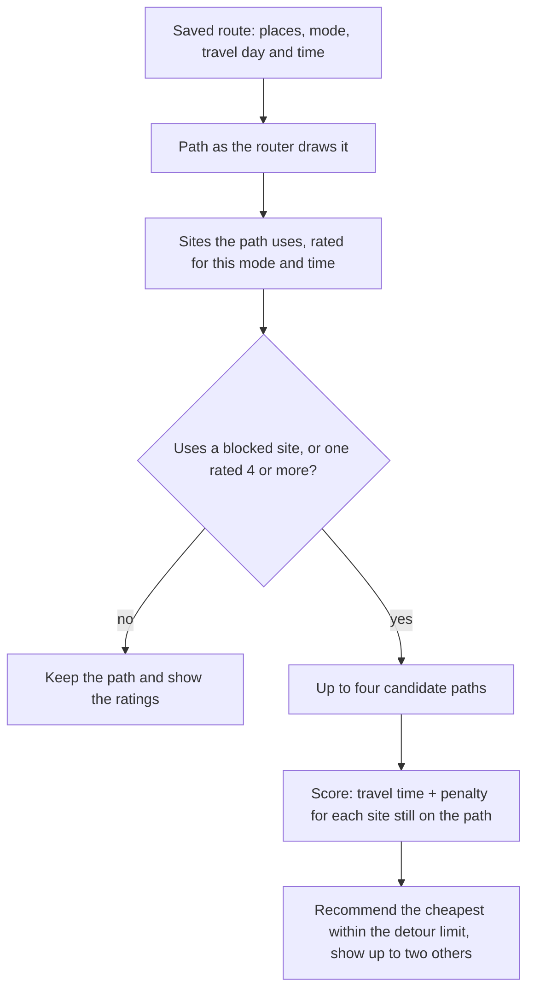

# Rating construction sites and finding a way around

Design and build · a 0–10 impact rating for each construction site, and how a route uses it to pick another path · 17 Oct 2026

> **Status:** the rating and the way the app explains it are built: see [section 3](#3-how-it-is-built) and [section 4](#4-being-transparent-about-the-scores). Finding another path ([section 2](#2-from-ratings-to-another-path)) is next.

Today a site counts as being on a route when its area comes within 30 m of the path, and every site counts the same. The route card says "Car · 3 construction sites on the way", whether the three are a closed motorway ramp or scaffolding on a residential street. This page proposes two things:

1. **A rating from 0 to 10 for each site**, for each mode (car, bike, walking) and travel time, with the reasons behind it.
2. **A way to use the ratings for another path**: when to look for one, which paths to try, and which one to recommend.

It builds on #12's closure kinds and penalties ([route-planning-open-questions.md](route-planning-open-questions.md)), the dashboard's severity and detour code ([planner-dashboard.md](planner-dashboard.md)) and idea 1 in [traffic-and-open-data-ideas.md](traffic-and-open-data-ideas.md). The numbers below come from the database functions in section 3, run over the 189 sites in the city's feeds on 17 Oct 2026 (136 current, 53 planned) with the open data loaded the same day. Site names below are corrected where the feed has typos.

## The short version

- **Rating = disruption (0–6) + surroundings (0–4), capped at 10.** Disruption is what the site does to this mode on this kind of road: a full closure is 6 on a main road and 1.8 on a residential street. Surroundings add points for a primary school nearby, a crossing on a school route inside the site, a kindergarten, a bus stop, a fire station or hospital, and other works close by.
- **The rating depends on mode and time.** The half closure on Kaiserstraße next to the Berswordt-Europa-Grundschule is 9/10 for a car at 8:00 on a school day, 5/10 on a Saturday, and 4/10 on foot, because of the four crossings on a school route inside it.
- **Today's sites, for a car at 8:00 on a school day:** 27 have no effect, 110 low (1–3), 40 medium (4–6), 9 high (7–8) and 3 severe (9–10). "3 sites on the way" becomes "3 sites · 1 high".
- **Blocked stays blocked.** A site the mode can't pass is avoided whatever its rating. The rating decides how hard to avoid the sites the mode *can* pass, and when to tell the user.
- **Finding another path:** ask the router for up to four paths (as drawn; around blocked sites; also around sites rated 7+; also around sites rated 4+). Score each as travel time plus 10 s × rating² for every site it still uses, and recommend the cheapest one within a detour limit. The dashboard's `planDetour` already routes around blocked sites on the FOSSGIS Valhalla server, without a key.
- **All the data is open:** the city's schools, kindergartens, care homes, hospitals, fire stations, Stadtbahn stops and street register, plus OpenStreetMap's crossings and bus stops. Two things are missing: where crossing guards (Schülerlotsen) stand, and where school entrances are.

## 1. The rating

```
rating = round( min(10, disruption + surroundings) )
disruption   = 6 × closure factor × road factor (× 1.3 for cars at rush hour), at most 6
surroundings = sum of the points in the table below, at most 4
```

Each line is rounded to 0.1 before it is added, so the breakdown the app shows adds up exactly. Scoring paths uses the unrounded sum; the app shows the rounded rating.

### Disruption: what the site does to this mode on this road (0–6)

**Closure factor**, from #12's impact for the mode. A site with several closure kinds takes the worst one, as #12 decided.

| Impact for the mode (#12) | Factor | For a car, e.g. |
|---|---|---|
| blocked | 1 | full closure, one-way rule |
| slowed by 120 s | 0.6 | half closure, one carriageway closed |
| slowed by 60 s | 0.4 | narrowing, temporary lights, moving works |
| slowed by 30 s | 0.25 | (bike past a narrowing, walking at temporary lights) |
| none | 0 | closed sidewalk, parking lane, no restriction named |

**Road factor**, from the city's street register (`fb62-strassenabschnitte`), matched the way the dashboard does it: the road's centre line runs at least 30 m through the site, or 10 m if the title names the street.

| Road | Car, bike | Walking |
|---|---|---|
| main road (Hauptverkehrstraße, roads to motorways and federal roads) | 1 | 1 |
| through road (Verkehrsstraße) | 0.6 | 0.8 |
| any other street | 0.3 | 0.6 |

The car and bike factors are the dashboard's road weights. Walking gets flatter ones, because a closed sidewalk on a residential street still sends people into the road or across it.

**Rush hour:** × 1.3 for cars on main and through roads, Mon–Fri 7:00–9:00 and 16:00–18:00, when the site slows traffic rather than blocking it. In the city's 2019 mobility survey, car trips that started between 16:00 and 17:00 took 1.67 times their routed time, against 1.25 between 5:00 and 6:00: about 1.3 times as long (idea 3 in the traffic ideas).

Some results: a full closure on a main road is 6. A half closure on a main road is 3.6, or 4.7 at rush hour. A full closure on a residential street is 1.8, and a narrowing there is 0.7.

### Surroundings: who else is there (0–4)

These points count only when the disruption is above 0. For walking they also count when a crossing with lights or markings lies within 20 m of the site. A closed parking lane next to a school stays at 0.

| Factor | Test | Car | Bike | Walk | When |
|---|---|---|---|---|---|
| School | within 150 m of a primary or special school (Grundschule, Förderschule); of any other school | +1.5; +1 | +1.5; +1 | +1.5; +1 | school days, 7:00–17:00 |
| Crossing on a school route | a crossing with lights or markings within 20 m of the site and within 300 m of a primary or special school | +1.5 | +1.5 | +1.5 | school days, 7:00–17:00 |
| Other crossing | a crossing with lights or markings within 20 m of the site | +0.5 | +0.5 | +1 | whenever the row above doesn't count |
| Kindergarten or care home | within 100 m of a kindergarten, a day-care centre for older people or a home for people with disabilities | +0.5 | +0.5 | +1 | kindergartens weekdays 7:00–17:00; homes always |
| Emergency access | within 500 m of a fire and rescue station or 300 m of a hospital | +1 | | | always |
| Public transport | a bus stop within 30 m or a Stadtbahn stop within 50 m | +0.5 | +0.5 | +1 | always (later: while the line runs) |
| Other works nearby | another site within 300 m that gets 3 or more disruption points for cars (e.g. a half closure of a main road), running on the same day | +1 | +1 | | while both run |

School points count for drivers too. A site next to a school at 8:00 means children crossing, parents stopping and often a 30 km/h limit, so driving through is slower and riskier. School days come from OpenHolidays, which the dashboard already reads. The NRW autumn holidays run from 17 to 31 Oct 2026, so no school points count today.

### Bands, time and dates

| Rating | Band | Route card and site panel |
|---|---|---|
| 0 | none | "next to your route, no effect" |
| 1–3 | low | grey |
| 4–6 | medium | amber |
| 7–8 | high | red |
| 9–10 | severe | red, and named in notifications |

- The rating always comes with its main reasons: "9/10 · half closure on a main road at rush hour · Berswordt-Europa-Grundschule 83 m · 4 crossings on a school route".
- Sites that run only during the day ("tagsüber") rate 0 outside 6:00–22:00, as decided for #12.
- A site that isn't active on the travel day rates 0. A planned site shows its future rating: "from 2 Nov: 10/10".

### Examples from today's feeds

Rated for a car and for walking at 8:00 on Monday 2 Nov, a school day (car score in brackets):

| Site | Car | Walk | Why, for a car |
|---|---|---|---|
| Asselner Hellweg, Donnerstraße, Am Hagedorn: fibre, partly full closure (planned, 2–20 Nov) | 10 (9.5) | 6 | full closure on a main road 6 · Hellweg-Grundschule 126 m +1.5 · 8 crossings on a school route +1.5 · bus stop +0.5 |
| Flughafenstraße: resurfacing, full closure (planned, 19–28 Oct) | 10 (10.0) | 6 | full closure on a main road 6 · Erich Kästner-Schule 72 m +1.5 · crossing on a school route +1.5 · kindergarten +0.5 · bus stop +0.5, capped at 4 |
| Kaiserstraße: renewing masts, half closure and lane reduction (until 13 Nov) | 9 (8.7) | 4 | half closure on a main road 3.6 · rush hour +1.1 · Berswordt-Europa-Grundschule 83 m +1.5 · 4 crossings on a school route +1.5 · kindergarten +0.5 · bus stop +0.5 |
| Wellinghofer Straße: power line, half closure with temporary lights (until 28 Oct) | 8 (7.7) | 4 | half closure on a main road 3.6 · rush hour +1.1 · Brücherhofschule 95 m +1.5 · emergency access +1 · bus stop +0.5 |
| A40 ramp at DO-Kley towards Dortmund: crash barriers, full closure (until 20 Nov) | 7 (6.5) | 3 | full closure on a main road 6 · 2 crossings +0.5; the works close by have ended by 2 Nov |
| Wittbräucker Straße: fibre, half closure (until 20 Nov) | 5 (5.2) | 0 | half closure on a main road 3.6 · rush hour +1.1 · bus stop +0.5 |
| Hülshof / Oberfeldstraße: replacing traffic lights, narrowing (until 3 Nov) | 4 (3.6) | 3 | narrowing on a main road 2.4 · rush hour +0.7 · 2 crossings +0.5 |
| Heroldstraße: district heating, full closure (until 13 Nov) | 4 (4.3) | 3 | full closure on a residential street 1.8 · Grundschule Kleine Kielstraße 110 m +1.5 · another site nearby +1 |
| Bodelschwingher Straße 211–217: roof and façade, narrowing and closed sidewalk (until 27 Nov) | 3 (3.1) | 6 | narrowing on a main road 2.4 · rush hour +0.7. On foot: closed sidewalk on a main road 6 |
| Sommerbergweg: power and water connection, full closure (from today to 13 Nov) | 2 (2.3) | 2 | full closure on a residential street 1.8 · bus stop +0.5 |

### What today's sites look like

| | none (0) | low (1–3) | medium (4–6) | high (7–8) | severe (9–10) |
|---|---|---|---|---|---|
| Car, school day 8:00 (all 189) | 27 | 110 | 40 | 9 | 3 |
| Bike, school day 8:00 (all 189) | 27 | 126 | 27 | 7 | 2 |
| Walk, school day 8:00 (all 189) | 74 | 92 | 23 | 0 | 0 |
| Car, today, Saturday 12:00, autumn holidays (136 active) | 19 | 91 | 22 | 4 | 0 |

For a car, 23 of the 189 sites fall in a different band at 8:00 on a school day than at noon on a holiday.

What the inputs look like across the 189 sites:

- 36 are on main roads, 21 on through roads and 132 on other streets. 10 are full closures on main roads.
- 91 block cars and bikes (full closures and one-way rules), and 10 block walking (closed sidewalks).
- 31 lie within 150 m of a school, 20 of them near a primary or special school.
- 25 have a crossing with lights or markings within 20 m; at 11 of them the crossing is on a school route.
- 25 lie within 100 m of a kindergarten, 47 at a bus or Stadtbahn stop, and 12 near a fire and rescue station or a hospital.
- 21 have another site within 300 m that gets 3 or more disruption points for cars.

## 2. From ratings to another path



### Step 1: which sites the path really uses

"Within 30 m" also catches sites on side streets that the path only crosses. Use the dashboard's test instead (`sitesAlongPath`): how much of the path lies within 5 m of the site's area.

| The path… | Test | Weight |
|---|---|---|
| uses the site's street | more than 20 m inside | 1 |
| crosses it, e.g. straight over a junction with a closed side street | 20 m or less inside | 0.3 for slowed sites; 0 for blocked ones, since the junction stays open |
| passes next to it | within 30 m, not inside | 0, shown as "next to your route" |

A site's effective rating on a path is its rating × weight.

### Step 2: when to look for another path

Look for another path when the current one uses a site that blocks the mode, or a site with an effective rating of 4 or more. Otherwise keep the path and show the ratings. On a school morning, that covers 112 of today's 189 sites for cars: 91 blocking ones, plus 21 that only slow traffic but rate 4 or more.

### Step 3: candidate paths

| Candidate | Avoids | Purpose |
|---|---|---|
| A. As drawn | nothing | the baseline, for "+3 min" (#25) |
| B. Around blocked sites | sites the mode can't pass | the least it must do |
| C. Around high sites | blocked sites and sites rated 7 or more | |
| D. Around medium sites | blocked sites and sites rated 4 or more | |

Skip a candidate when it would avoid the same sites as the one before it, e.g. C when no site on the way rates 7 or more.

**The router.** #12 chose openrouteservice (`avoid_polygons`), but we don't have an ORS key yet. The dashboard already avoids sites on FOSSGIS's public Valhalla server with `exclude_polygons` (`dashboard/src/routing/valhalla.ts`). It excludes a 30 m square where the path runs through each site, asks again, and repeats for up to three rounds, because the new path can run into new sites. Each request takes at most 19 squares (the server's 100-vertex limit), and the dashboard sends at most one request a second. Use the same loop for candidates B–D, and switch to ORS when we have a key; only the call changes.

The app draws paths with FOSSGIS's OSRM today (`mobile/src/routes/routePath.ts`), which can't avoid areas. Candidate A should come from the same router as B–D, so that their times compare.

**Cost:** at most 4 candidates × 3 rounds = 12 requests, or 12 s at one request a second. Usually it's 2–4, because candidates repeat. Show candidate A at once and the recommendation when it arrives. Replanning saved routes in the background (#12) isn't in a hurry.

### Step 4: score each candidate

```
cost = travel time + Σ over the sites still on the path: 10 s × (effective rating)²
```

| Rating | 1 | 2 | 3 | 4 | 5 | 6 | 7 | 8 | 9 | 10 |
|---|---|---|---|---|---|---|---|---|---|---|
| Penalty | 10 s | 40 s | 1½ min | 2⅔ min | 4 min | 6 min | 8 min | 10⅔ min | 13½ min | 16⅔ min |

So a detour of up to about 2½ minutes is worth taking to avoid a 4/10 site, and up to about 11 minutes for an 8/10. Squaring keeps low ratings almost free and makes high ones expensive. The penalty replaces #12's `penalty_s`, because the disruption part already includes it; don't add both. For comparison, #12 counts a half closure as a flat 120 s. Here it costs 130 s on a main road (3.6) and about 10 s on a residential street (1.1), plus whatever its surroundings add.

A path through a blocked site is out, unless every candidate goes through one. In that case show the least obstructed one and name the site in the way, as #12 does.

### Step 5: pick, show and notify

- Drop candidates more than 50 % or 15 minutes slower than A, unless A goes through a blocked site.
- Drop near-duplicates: a candidate that shares more than 85 % of its length with a cheaper one.
- Recommend the cheapest. Show up to two others in grey (#12).
- Explain the choice: "Recommended · 18 min (+4) · avoids Kaiserstraße (9/10)". If the recommended path still uses a site rated 4 or more, name it with its reasons.
- Send a notification (#25) when the recommended path changes, or when a site rated 7 or more appears on it.

**Example** (the travel times are made up; the ratings come from the data). A car route runs along Kaiserstraße. Path A takes 14 min; path D goes around the site in 18 min and passes a narrowing on a residential street (0.7).

| | A, through Kaiserstraße | D, around it | Recommended |
|---|---|---|---|
| Monday 8:00, school day | 14 min + 10 s × 8.7² = 26.6 min | 18 min + 5 s = 18.1 min | D, +4 min |
| Saturday 12:00 | 14 min + 10 s × 4.6² = 17.5 min | 18.1 min | A |

## 3. How it is built

All of it lives in Postgres, as #12 decided for the construction-site logic, so the app, the dashboard and the obstacles job can share one score. Migration: [`20261017120000_site_ratings.sql`](../backend/supabase/migrations/20261017120000_site_ratings.sql); tests: [`site_ratings.test.sql`](../backend/supabase/tests/database/site_ratings.test.sql).

| Part | What it holds or does |
|---|---|
| `closure_kind`, `impact`, `closure_impacts` | #12's closure kinds, with each one's impact and penalty for each mode |
| `classify_closures(title)`, `is_daytime_only(title)` | what a site closes, read from its title with the dashboard's patterns |
| `rating_weights` | every number in section 1, radii and hours included, each with a description. Change a value with an `update`; no release needed |
| `places`, `roads`, `school_free_days` | schools, kindergartens, care homes, hospitals, fire stations and Stadtbahn stops (city); crossings and bus stops (OSM); main and through roads (street register); school and public holidays (OpenHolidays) |
| `private.sync_places()` | loads all of the above; pg_cron runs it at 03:30 UTC on the 1st of each month. Each source replaces its rows only when it returned some, so an outage keeps the last good data |
| `site_context` | one row per site: closures, road class and name, the nearest school, primary school, kindergarten, care home, hospital, fire station, bus and Stadtbahn stop with their distances, the crossings and school-route crossings, other serious works close by |
| `private.refresh_site_context()` | fills `site_context`; pg_cron runs it at :02, after the hourly site sync |
| `site_ratings(mode, at, site_ids)` | the rating, band, impact, whether the site runs then, the two parts, and `reasons`: every factor with its points and details, and why it doesn't count at that time when it doesn't |
| `obstacles.along_m` | how far a route's path runs inside each site on its way, measured by a trigger whenever the obstacles job writes a row |
| `route_departure(...)`, `route_site_ratings(route)` | a route's sites, rated for its mode at its next leaving time, with how the route meets each one (uses, crosses, passes) and the share that counts |

Everything in the table can be read with the publishable key, so anyone can check a score against its inputs. Only the jobs write.

To set it up on a database, paste the migration into the SQL editor, then run `select private.sync_places();` and `select private.refresh_site_context();` once, or wait for the jobs. The sync takes about a minute.

## 4. Being transparent about the scores

A score nobody can check is a score nobody should trust, so the app never shows the number on its own:

- **Who and when.** "9/10 · Severe impact · for cars · Mon 2 Nov, 08:00". On a route, the score is for the route's mode at its next leaving time. Without one, the card has Car, Bicycle and Pedestrian buttons, and the score is for now.
- **Every point.** One line per factor, with its points: "Half closure and lane narrowing on Kaiserstraße (main road) · Slows cars by about 2 min · 6 × 0.6 × 1 · +3.6", "Berswordt-Europa-Grundschule, 83 m away · +1.5", and so on.
- **What doesn't count, and why.** A factor that applies but doesn't count at that time stays on the list with 0 points: "Not counted: school holidays (Herbstferien)", "Not counted: weekend", "Not counted: not rush hour". A cap shows as a line of its own: "Surroundings count 4 points at most · −1.0".
- **How it adds up.** "Closure 4.7 + surroundings 4.0 = 8.7, rounded to 9/10".
- **What it means for the route.** "Your route runs 150 m through it, so all of it counts", or "Your route only crosses it, so 30 % counts: 2.6".
- **How scores work.** A sheet one tap away explains the method with the values the server uses right now (read from `rating_weights`), where the data comes from and how often it is loaded, and what the score can't know: crossing guards, school entrances, live traffic, vague titles, and that the weights are judgement calls.

The app puts the reasons the server returns into words ([`mobile/src/ratings/model.ts`](../mobile/src/ratings/model.ts)); the server never sends a number without the reasons behind it.

## 5. Data

Checked on 17 Oct 2026.

| Source | What | Count | Used for |
|---|---|---|---|
| `schulen` (city) | schools, address points | 183: 93 Grundschulen, 25 Förderschulen, 19 Gymnasien, 15 Realschulen, 14 Hauptschulen, 13 Gesamtschulen, 3 other (1 traffic school left out) | school points |
| `kindergarten` (city) | kindergartens | 333 | kindergarten points |
| `tagespflegeeinrichtung`, `behindertenwohnheim` (city) | day care for older people, homes for people with disabilities | 26, 60 | care-home points |
| `krankenhaus`, `feuerwehr` (city) | hospitals, fire stations; the dashboard keeps the professional Feuer- und Rettungswachen | 27, 32 | emergency access |
| `haltestellen` (city) | Stadtbahn, S-Bahn and regional stops | 123 | public transport |
| `fb62-strassenabschnitte` (city) | street segments with road class | 19,510 | road factor |
| `fb66-baustellen-…-flachen` (city) | construction sites with areas | 136 current, 53 planned | everything |
| OpenStreetMap via Overpass | crossings | 5,800: 1,696 with lights, 434 marked, 410 uncontrolled, 2,253 unmarked; 298 of them are zebras | crossing points: `crossing=traffic_signals` or `marked`, or `crossing_ref=zebra` |
| OpenStreetMap via Overpass | bus stops | 1,980 | public transport |
| OpenHolidays API | NRW school holidays | | school days |

The city's datasets are under Datenlizenz Deutschland – Zero 2.0. OpenStreetMap data is under the ODbL and needs "© OpenStreetMap contributors" next to anything derived from it.

### Checked, and not there

- **Crossing guards (Schülerlotsen):** not in the city's portal. No crossing in Dortmund is tagged as supervised in OSM (`supervised=yes` or `crossing:supervision`: 0). Ask the city, or the schools, where they stand; they're the strongest school-route signal there is.
- **School route plans (Schulwegpläne):** not in the portal.
- **School entrances:** the city gives one address point per school, hence the 150 m. OSM has 190 school grounds as areas; measuring from a ground's edge would be more accurate.
- **School-zone speed limits:** 280 road pieces in OSM have a time-dependent limit, but more than half are night-time noise limits (152, e.g. 120 at "30 @ (21:00-05:00)"). Only about 100 are daytime 30 km/h limits like "30 @ (Mo-Fr 07:00-18:00)", too few to rely on alone.
- **Traffic volumes:** not open (see the traffic ideas). The road class stands in for them; Mapbox's congestion (idea 2) could later replace the rush-hour factor.

## 6. Tuning and checking

- Every weight here is a judgement call. For the first month, check the top 20 sites by hand each week: does each 9/10 deserve it?
- Keep the high and severe bands small, or the label stops meaning anything. Today they hold 12 of 189 sites for cars on a school morning (6 %).
- When idea 2's traffic data arrives, check whether high-rated sites really slow traffic more, and fit the road and rush-hour factors to it.
- Let users answer "worse / as rated / better" for a site they passed, and look at the answers per band.

## 7. Open questions

1. **School points for drivers.** Should they raise a driver's rating, or only count for walking and cycling? Proposed: for all modes, as above. And should the planner keep car detours off streets next to schools, so that avoiding one school doesn't send traffic past another?
2. **Number or band?** Proposed: the band colour on the map, and the number with its reasons on the site card.
3. **Emergency access.** It matters to the city (the dashboard), less to whether one driver gets through. Proposed: keep it, +1 for cars only.
4. **Detour tolerance per mode.** Five minutes on foot is about 400 m, which walkers may mind more than drivers mind 5 minutes in a car. Proposed: the same formula, with a factor per mode in `rating_weights`, starting at 1.
5. **"Avoid school zones" setting.** #12 decided against an "avoid all construction" switch for now. A narrower setting for school zones could make sense for parents.
6. **Crossing guards.** Ask the city for their positions?

## 8. Steps

| Step | What | Status |
|---|---|---|
| 1 | `places` sync (city and OSM), and `site_context` after each site sync | done |
| 2 | `rating_weights` and `site_ratings()`, with SQL tests built on the examples above | done |
| 3 | The score with every point on the site card; "· 1 with high impact" on the route card; "How scores work" | done |
| 4 | Candidates and scoring in the planner: Valhalla now, ORS once we have a key | next, a few days |
| 5 | The recommended path and up to two others on the route map, with reasons | a few days |
| 6 | Notifications (#25) for a new site rated 7 or more, or a changed recommendation | about a day |
